# Tersane Entegrasyon

**Tersane iç uygulaması + ERP entegrasyonu + RPA botu: uçtan uca çalışan bir .NET vitrin projesi.**
Üretim planlama ekibi bir gemi projesi (tekne no), blok ve iş emri için malzeme talebi açar. Talep ERP'de satınalma
talebine dönüşür. ERP'deki onay, mal kabul ve stok bilgisi iç sisteme geri akar. API'si olmayan eski bir ambar
ekranına ise irsaliye satırlarını bir RPA botu Excel'den girer.

> [!IMPORTANT]
> **Bu bir demo / portfolyo projesidir.** Gerçek bir şirkete ait değildir, gerçek şirket verisi içermez.
> Projeler, armatörler, tedarikçiler ve malzeme kodları **kurgusaldır**.
> **ERP sahtedir (mock).** `Tersane.ErpMock`, IFS Cloud'un OData "projection" *tarzını* taklit eden küçük bir servistir.
> IFS Cloud değildir, IFS'in şemasını veya kodunu kullanmaz. Amaç, gerçek bir ERP'ye bağlanırken karşılaşılan sorunları
> (kimlik doğrulama, kesinti, mükerrer kayıt, delta senkron) gösterebilmektir.

| | |
|---|---|
| **İç uygulama** | ASP.NET Core 10 MVC: Razor, jQuery (bağımlı listeler, dinamik satırlar, AJAX), Bootstrap 5 + özel CSS |
| **Veritabanı** | SQL Server 2022, EF Core 10 (migration'lar) + T-SQL saklı yordamlar, view, inline TVF, TVP, `MERGE`, `OPENJSON`, `FOR JSON`, sequence |
| **Sahte ERP** | ASP.NET Core OData v4: `$filter/$select/$orderby/$top`, sunucu sayfalama, OAuth2 client credentials, 409/400 hataları, kaos anahtarları |
| **Entegrasyon** | .NET BackgroundService: transactional outbox, idempotency, Polly (retry + circuit breaker + timeout), entegrasyon log tablosu, arayüzden yeniden işleme, watermark ile delta senkron |
| **RPA** | Playwright for .NET + ClosedXML: Excel'den okur, eski jQuery formuna girer, ekran görüntüsü + log + sonuç Excel'i üretir |
| **Eski sistem** | Bilerek eski tip bir form (tablo düzeni, `.aspx` adresler, `alert/confirm`, yavaş AJAX), ADO.NET ile SQL Server |
| **React panel (opsiyonel)** | Vite + React 19 + TypeScript + TanStack Query: canlı KPI'lar, son 60 dakikanın ERP çağrı grafiği (SVG), outbox listesi ([src/tersane-panel](src/tersane-panel)) |
| **PL/SQL (opsiyonel)** | Aynı outbox yordamlarının Oracle paketi: `FOR UPDATE SKIP LOCKED`, `BULK COLLECT/FORALL`, `MERGE`, virtual column; Oracle Free container'ında testli ([db/oracle](db/oracle)) |
| **Kalite** | 36 .NET testi: xUnit v3 + Testcontainers (gerçek SQL Server 2022), in-memory sahte ERP, headless Chromium ile RPA uçtan uca; 15 PL/SQL testi |
| **Çalıştırma** | `docker compose up` (5 servis + migration işi; RPA, React panel ve Oracle isteğe bağlı profil), GitHub Actions CI (build + test + compose smoke test + RPA + panel build + PL/SQL) |

## Mimari

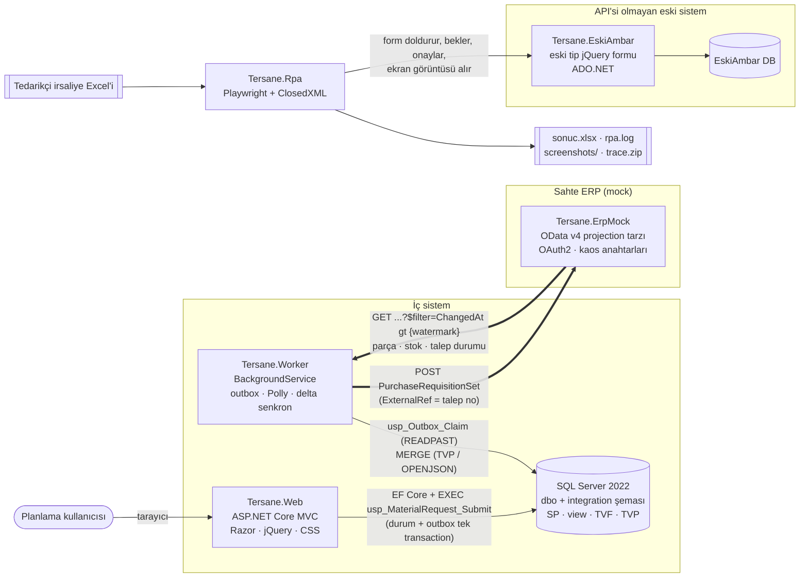

### Malzeme talebi akışı

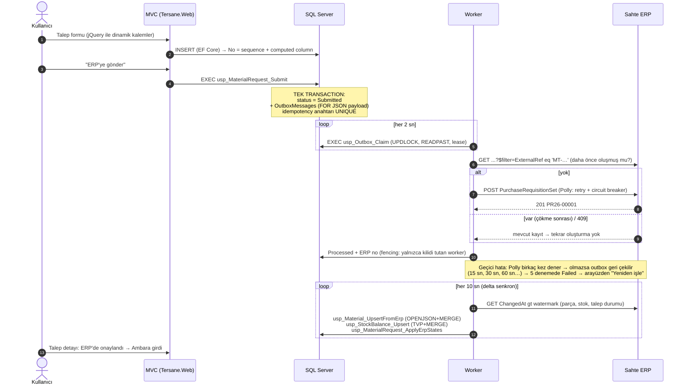

## Hızlı başlangıç

Gerekenler: Docker Desktop (Linux container). İlk derleme birkaç dakika sürer.

```powershell
docker compose up -d --build
```

| Adres | Ne |
|---|---|
| http://localhost:5100 | İç uygulama (MVC) |
| http://localhost:5100/entegrasyon | Entegrasyon izleme, hatalı mesajı yeniden işleme, ERP kaos anahtarları |
| http://localhost:5101 | Sahte ERP ekranı (talepler, stok, kaos ayarları) |
| http://localhost:5101/mock-erp/projection/v1/PartHandling.svc/$metadata | OData metadata |
| http://localhost:5102 | Eski ambar formu: `rpa.bot` / `Demo-Bot-2026` (demo değeri) |
| `localhost,14333` | SQL Server: `sa` / `Tersane_Demo_2026!` (demo değeri, `.env` ile değiştirilebilir) |

RPA botunu çalıştırmak (sonuçlar `./rpa-out/<zaman>/` klasörüne yazılır):

```powershell
docker compose --profile rpa run --rm rpa
```

Uçtan uca duman testi (Git Bash veya Linux/macOS; CI de bunu çalıştırır):

```bash
./scripts/smoke.sh
```

React izleme paneli (http://localhost:5104, `/api` çağrılarını nginx web uygulamasına yönlendirir):

```powershell
docker compose --profile panel up -d --build panel
```

Geliştirme modunda: `cd src/tersane-panel; npm install; npm run dev` → http://localhost:5173 (Vite, `/api` proxy'si `localhost:5100`'e).

PL/SQL örneği (Oracle Database Free; şema, paket ve testler ilk açılışta çalışır, logda `ALL ORACLE CHECKS PASSED`):

```powershell
docker compose --profile oracle up -d oracle
```

Durdurmak (veritabanı dahil her şeyi silmek için `-v`):

```powershell
docker compose --profile rpa --profile oracle --profile panel down -v
```

### Docker olmadan (geliştirme)

```powershell
docker run -d --name tersane-devsql -e ACCEPT_EULA=Y -e "MSSQL_SA_PASSWORD=Tersane_Dev_2026!" -p 14333:1433 mcr.microsoft.com/mssql/server:2022-latest
```

```powershell
dotnet run --project src/Tersane.ErpMock --launch-profile http
```

```powershell
dotnet run --project src/Tersane.Worker
```

```powershell
dotnet run --project src/Tersane.Web --launch-profile http
```

```powershell
dotnet run --project src/Tersane.EskiAmbar --launch-profile http
```

```powershell
dotnet run --project src/Tersane.Rpa -- --tarayici-kur
```

```powershell
dotnet run --project src/Tersane.Rpa -- --excel samples/ornek-irsaliye.xlsx --url http://localhost:5102 --headed --slowmo 300
```

Web uygulaması geliştirme ortamında migration'ları kendisi uygular (`Database:MigrateOnStartup`).
Docker'da bunu tek seferlik `db-migrate` servisi yapar (`dotnet Tersane.Web.dll --migrate`).

## Demo senaryoları

1. **Mutlu yol.** *Malzeme Talepleri → Yeni talep*: proje NB-1042, blok S201, iki kalem (ör. `12,5` metre profil).
   "Kaydet ve ERP'ye gönder" → birkaç saniye içinde ERP numarası gelir. Sahte ERP talebi 20 sn sonra onaylar, onaydan
   40 sn sonra malzemeyi teslim alır. Talep detayındaki adımlar ve stok sayfası kendiliğinden güncellenir.
2. **Geçici kesinti.** *Entegrasyon → ERP simülasyonu → "ERP kesintisi"* açın, yeni talep gönderin. Logda her HTTP denemesi
   (503) görünür: Polly hızlı denemeleri yapar, ardından mesaj artan aralıklarla bekler. Kesintiyi kapatınca mesaj kendiliğinden
   gider. Kesinti 5 deneme boyunca (yaklaşık 4 dakika) sürerse mesaj **Hatalı** olur; "Yeniden işle" ile kuyruğa geri alınır.
3. **Kalıcı hata.** `WL-E6013-32` (ERP'de satınalmaya kapalı) ile talep gönderin. ERP 400 döner, mesaj yeniden denenmeden
   **Hatalı** olur. Form bu malzeme için önceden uyarı da gösterir.
4. **Mükerrer kayıt yok.** Aynı talep için "gönder"e iki kez basmak tek outbox mesajı üretir (saklı yordam idempotent).
   Worker ERP'ye yazdıktan sonra çökse bile, yeniden denemede önce `ExternalRef` ile arar ve ikinci kaydı açmaz.
5. **RPA.** `docker compose --profile rpa run --rm rpa`: 10 satırlık örnek Excel'den 7'si girilir, 1'i dosya içi mükerrer
   olarak tanınır, 1'i eski sistemde olmayan malzeme kodu olduğu için reddedilir, 1'i Excel'de miktar boş olduğu için hiç
   denenmez. Botu ikinci kez çalıştırmak hiçbir fişi tekrar girmez ("Zaten kayıtlı").

## Öne çıkan teknik kararlar

**SQL Server / T-SQL** ([`src/Tersane.Data/Sql`](src/Tersane.Data/Sql))

| Nesne | Ne gösteriyor |
|---|---|
| `dbo.usp_MaterialRequest_Submit` | `XACT_ABORT`, `TRY/CATCH`, `UPDLOCK, HOLDLOCK`, `THROW 50xxx` iş kuralları, `FOR JSON PATH` ile iç içe JSON, transactional outbox, idempotency |
| `integration.usp_Outbox_Claim` | `UPDATE TOP(n) … OUTPUT` + `ROWLOCK, UPDLOCK, READPAST`: birden fazla worker aynı mesajı almaz; süresi dolan kilit (lease) geri alınır |
| `integration.usp_Outbox_Requeue` | "Yeniden işle" butonu; kim yaptı, önceki hata ne idi loglanır |
| `dbo.usp_StockBalance_Upsert` | Tablo değerli parametre (TVP) + `MERGE … WITH (HOLDLOCK)`; aynı sayfa tekrar gelirse hiçbir şey değişmez |
| `dbo.usp_Material_UpsertFromErp` | `OPENJSON … WITH`, ISO 8601 `Z`/`+03:00` → UTC `datetime2` |
| `dbo.usp_MaterialRequest_ApplyErpStates` | Durum yalnızca ileri gider (eski/tekrarlanan ERP olayı talebi geri almaz) |
| `dbo.vw_StockStatus`, `integration.vw_IntegrationHealth` | CTE'li view'lar; EF Core'da keyless entity |
| `dbo.fn_ProjectMaterialSummary` | Inline TVF; EF Core `HasDbFunction` ile LINQ'ten birleştirilebilir |
| Sequence + `PERSISTED` computed column | `MT-2026-00012` numarası; `FORMAT()` deterministik olmadığı için kullanılmadı |
| Filtreli index | `IX_OutboxMessages_Pending … WHERE [Status] = N'Pending'` |

**Entegrasyon** ([`src/Tersane.Worker`](src/Tersane.Worker))

- **İki seviyeli yeniden deneme.** Polly (Microsoft.Extensions.Http.Resilience): 3 hızlı deneme (üstel bekleme + jitter,
  `Retry-After`'a uyar), circuit breaker, deneme ve toplam timeout. Polly vazgeçerse outbox seviyesinde dakikalar mertebesinde
  geri çekilme. `MaxAttempts` sonunda **Failed** olur ve operatöre bırakılır.
- **Hata sınıflandırma.** 5xx/408/429/ağ hatası = geçici. 4xx = kalıcı (yeniden denenmez). 409 = "zaten var" (başarı).
- **Idempotency üç katman.** DB'de `UNIQUE (IdempotencyKey)`, ERP'ye yazmadan önce `ExternalRef` ile arama, ERP'nin 409'u.
- **Fencing.** Mesajı yalnızca kilidi hâlâ tutan worker tamamlayabilir (`WHERE LockedBy = @me`).
- **Delta senkron.** `ChangedAt gt watermark`, `@odata.nextLink` takibi, sınırda kayıt kaçmasın diye küçük bir örtüşme penceresi.
  Upsert'ler idempotent olduğu için örtüşme zararsız.
- **Log.** Her HTTP denemesi (Polly denemeleri dahil) süre, durum kodu ve kısaltılmış gövdeyle `integration.IntegrationLogs`'a
  yazılır. Okuma çağrıları yalnızca hata verirse loglanır, böylece log gürültüye boğulmaz.
- **OAuth2 client credentials.** Token önbelleklenir. 401 gelirse yenilenip çağrı bir kez tekrarlanır.

**RPA** ([`src/Tersane.Rpa`](src/Tersane.Rpa))

- Seçiciler WebForms tarzı üretilmiş ID'ler yerine görünen etiketlerle yazıldı (`GetByLabel("Miktar")`).
- `Thread.Sleep` yok. Bot somut bir durumu bekler: raf seçeneği yüklendi mi, malzeme sorgusu bitti mi, sonuç etiketi çıktı mı.
- `confirm()` kabul edilir, `alert()` metni hata olarak kaydedilir. Oturum düşerse bot yeniden giriş yapar.
- Teknik hatalar (timeout) yeni sayfada yeniden denenir. İş kuralı redleri denenmez, kaydedilir.
- Her satır için "doldurulmuş form" ve "sonuç" ekran görüntüsü, `rpa.log`, renkli `sonuc.xlsx` ve isteğe bağlı Playwright `trace.zip`.

**Kültür / yerelleştirme.** Arayüz tr-TR (`12,5`, `1.250,5`). jQuery Validation, sunucudaki tr-TR model bağlama ile aynı kuralı
kullanacak şekilde ayarlandı. Kodlar `ToUpperInvariant()` ile normalize edilir (tr-TR'de `"i".ToUpper()` = `"İ"`). Kaos
anahtarındaki oran, tr-TR'de `"0.3"` değeri 3 olarak okunacağı için tam sayı yüzde olarak taşınır.

## Testler

```powershell
dotnet test
```

Docker çalışıyor olmalı: Testcontainers bir SQL Server 2022 container'ı açar, her test sınıfı kendi veritabanını migrate eder.
RPA uçtan uca testi Chromium kurulu değilse atlanır (`dotnet run --project src/Tersane.Rpa -- --tarayici-kur`).

| Sınıf | Kapsam |
|---|---|
| `DatabaseTests` (13) | Programlanabilir nesneler, sequence/computed column, submit'in tek transaction olması, idempotency, iş kuralı hatası, 6 paralel worker'ın 60 mesajı çakışmadan alması, lease süresi dolan mesaj, requeue, TVP+MERGE idempotency, stok view'ı, ileri-yönlü durum, OPENJSON, TVF |
| `IntegrationWorkerTests` (8) | Senkron, uçtan uca teslim, çökme sonrası mükerrer olmaması, Polly'nin 503'leri yutması, uzun kesinti → Failed → yeniden işle, kalıcı hata (retry yok), ERP onay/mal kabul akışı, iptal edilen token'ın yenilenmesi |
| `ErpMockTests` (3) | Token zorunluluğu, OData `$filter/$select`, sunucu sayfalama, 409 |
| `WebTests` (10) | 8 sayfa render, anti-forgery korumalı form post (`12,5` → 12.5), token'sız POST'un reddi |
| `RpaExcelTests`, `RpaEndToEndTests` (2) | Excel okuma (tr sayılar, veri hataları), gerçek Kestrel + headless Chromium ile bot |

## Proje yapısı

```text
src/
  Tersane.Data/         EF Core modeli, migration'lar, Sql/*.sql (T-SQL), TersaneSql (SP sarmalayıcıları), demo verisi
  Tersane.Web/          ASP.NET Core MVC iç uygulama (Controllers, Views, wwwroot/js, wwwroot/css)
  Tersane.Worker/       Entegrasyon worker'ı: Erp/ (istemci, token, audit), Outbox/, Sync/
  Tersane.ErpMock/      Sahte ERP (OData projection tarzı) + demo ekranı
  Tersane.EskiAmbar/    Eski tip ambar giriş formu (Razor Pages, jQuery, ADO.NET)
  Tersane.Rpa/          RPA botu (Playwright, ClosedXML) + Dockerfile
  tersane-panel/        React (Vite + TypeScript) izleme paneli, nginx Dockerfile
tests/Tersane.Tests/    xUnit v3 + Testcontainers
db/oracle/              PL/SQL paketi (spec + body), şema, testler; compose "oracle" profili
samples/                ornek-irsaliye.xlsx (RPA girdisi)
scripts/smoke.sh        compose üzerinde uçtan uca duman testi
docs/                   görüşme notları, ekran görüntüleri
```

## Ekran görüntüleri

| | |
|---|---|
| 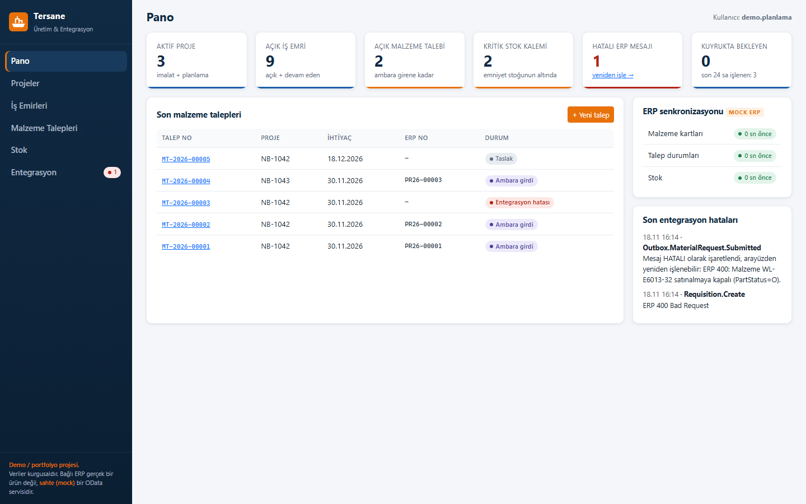 | 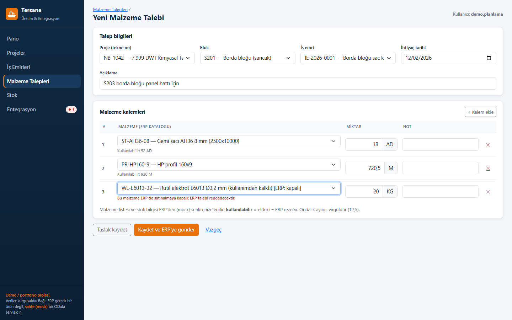 |
| Pano: açık talepler, kritik stok, hatalı ERP mesajları, senkron durumu | Dinamik kalemler, canlı stok ipucu, ERP'de kapalı malzeme uyarısı |
| 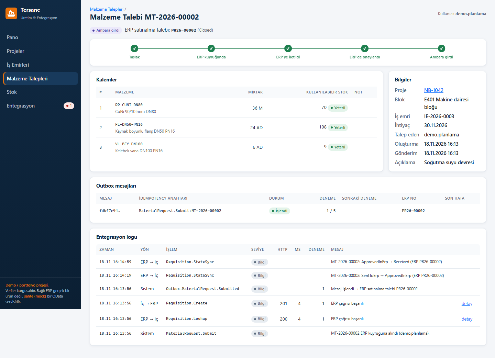 | 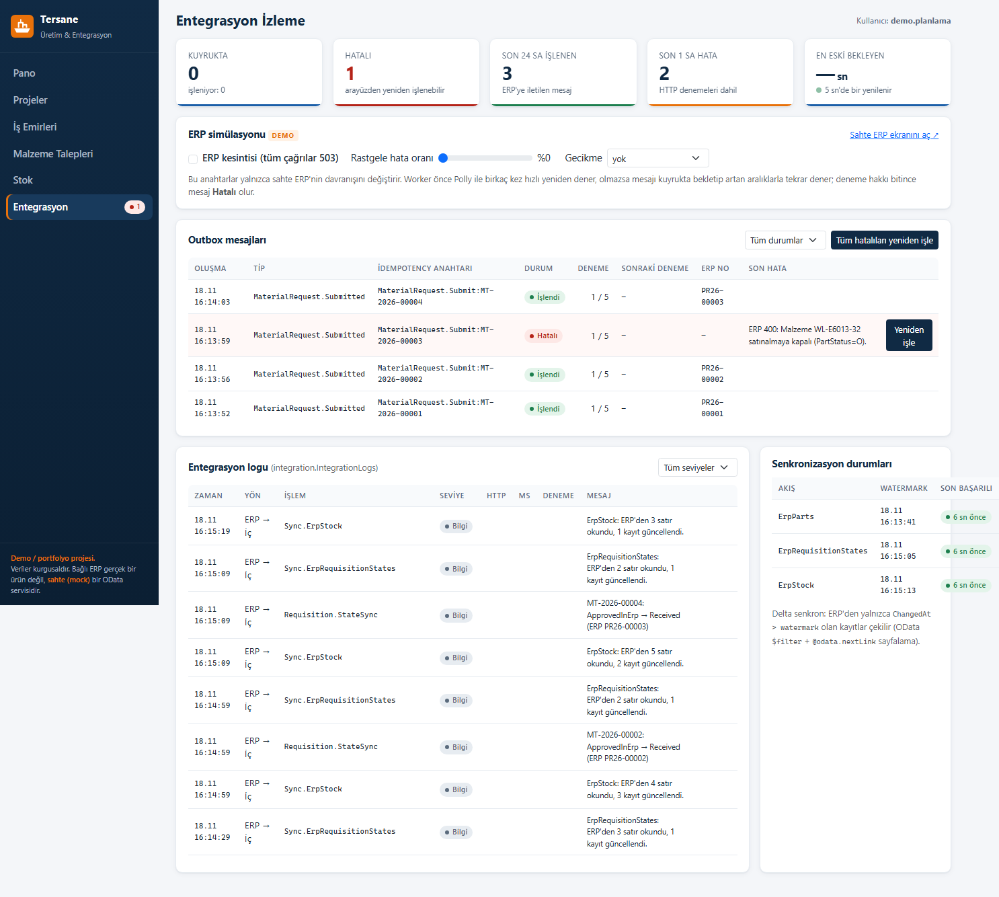 |
| Talep yaşam döngüsü, outbox mesajı, ilgili entegrasyon logu | Outbox, hatalı mesajı yeniden işleme, log, senkron watermark'ları, kaos anahtarları |
| 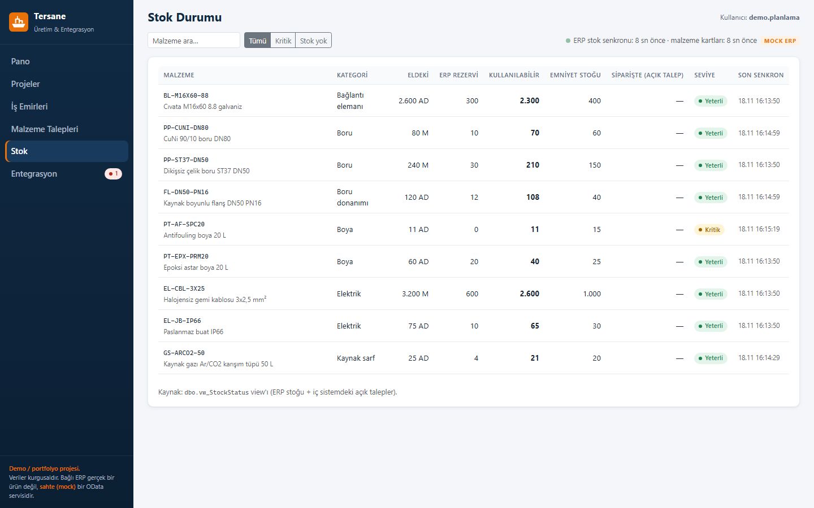 | 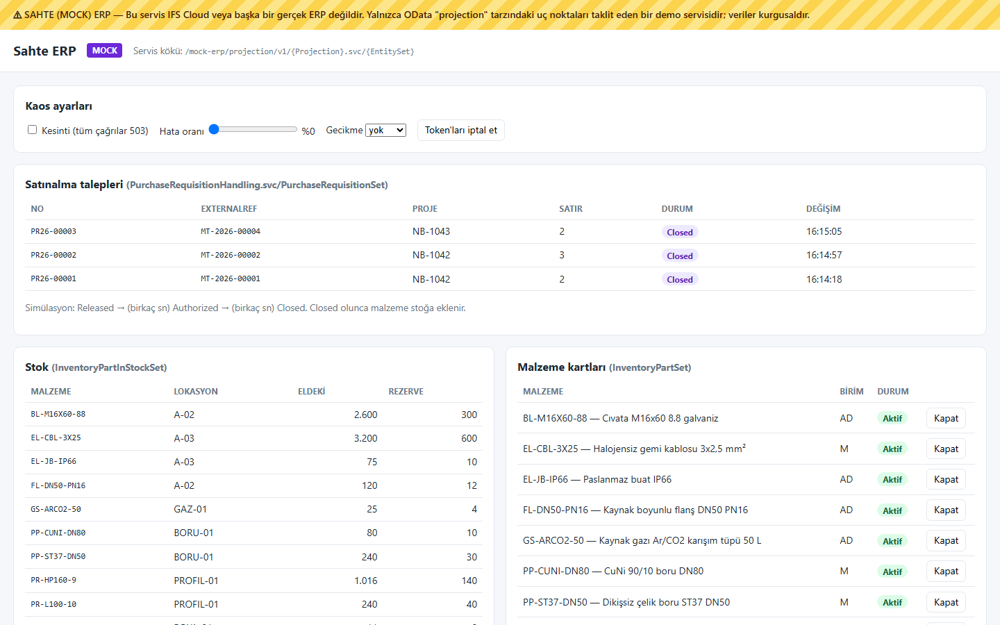 |
| `vw_StockStatus`: eldeki, ERP rezervi, kullanılabilir, siparişte | Sahte ERP ekranı (açıkça "mock" etiketli) |
| 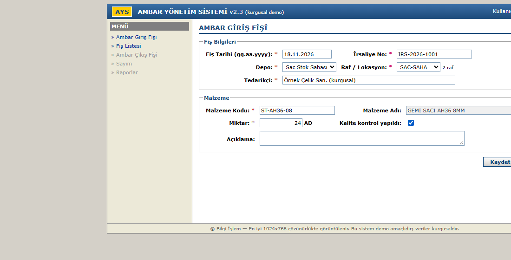 | 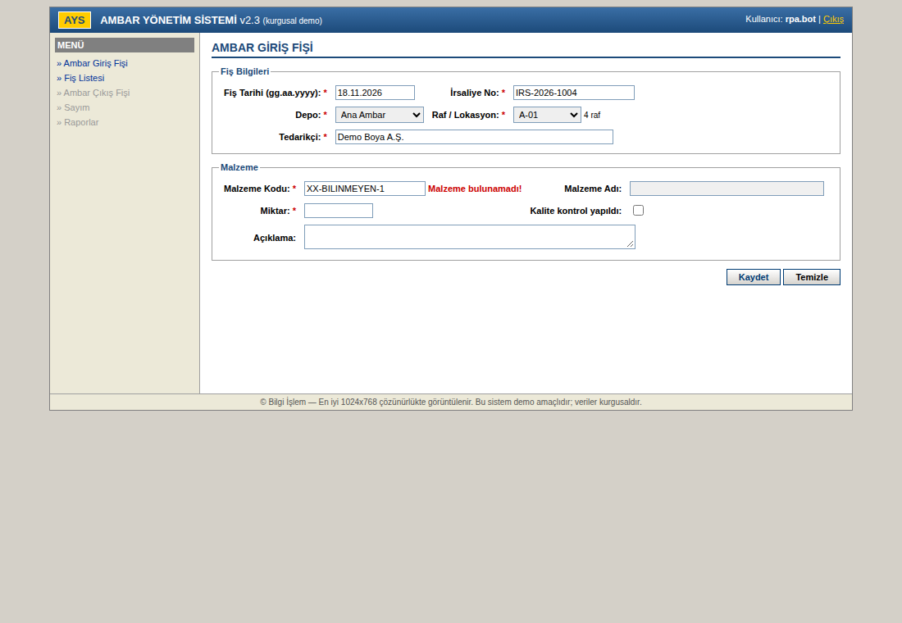 |
| RPA'nın hedefi: eski tip ambar giriş formu | Botun kaydettiği red: eski sistemde olmayan malzeme kodu |
| 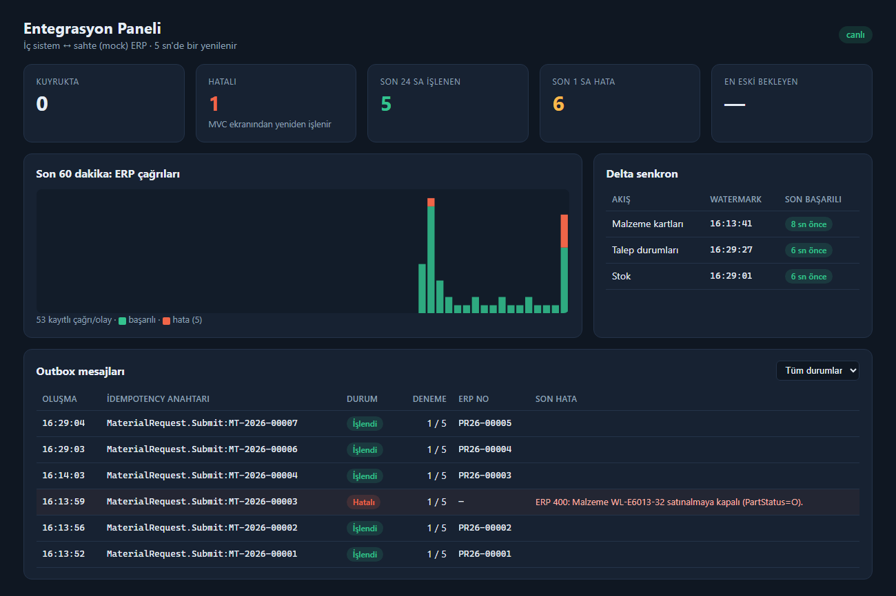 | |
| React izleme paneli: %40 hata oranında 503'ler grafikte, mesajlar yine ilk denemede işlenmiş (Polly) | |

## Bilinen sınırlamalar

- Sahte ERP verisi bellekte tutulur. `erp-mock` container'ı yeniden başlarsa ERP tarafı sıfırlanır (iç sistem etkilenmez).
- İç uygulamada oturum açma yok; kullanıcı adı yapılandırmadan gelir. Şirket içi bir kurulumda Windows Authentication /
  Active Directory veya OpenID Connect kullanılırdı.
- Tek ERP akışı modellendi (malzeme talebi → satınalma talebi). Gerçek bir projede iş emri, malzeme çıkışı, maliyet gibi
  akışlar aynı outbox/handler yapısına eklenir.

## Lisans

MIT. Ayrıntılar için [LICENSE](LICENSE) dosyasına bakın.
